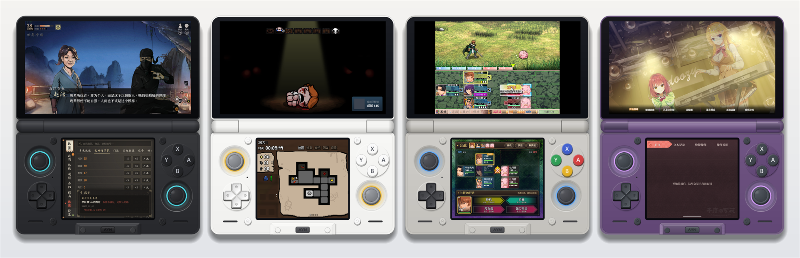
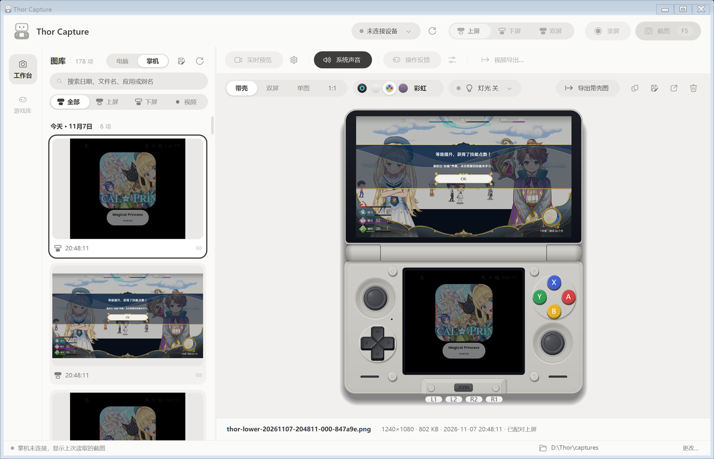
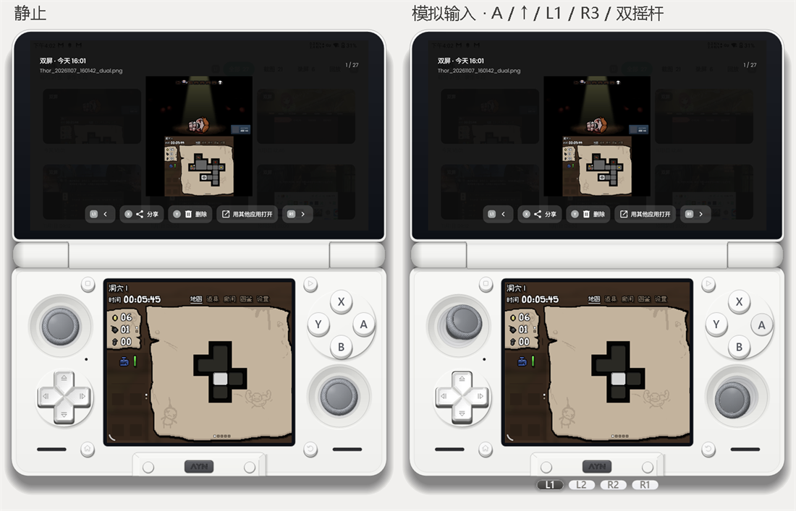
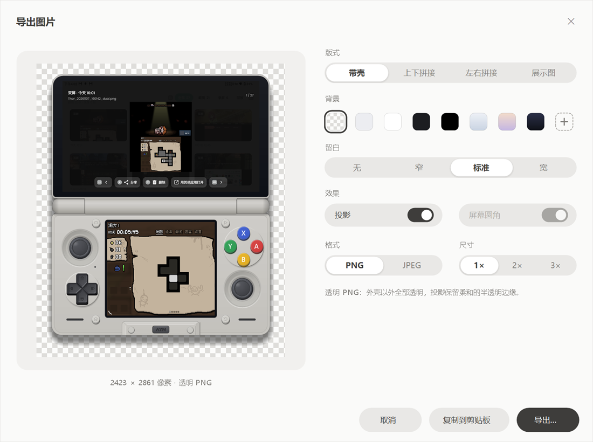
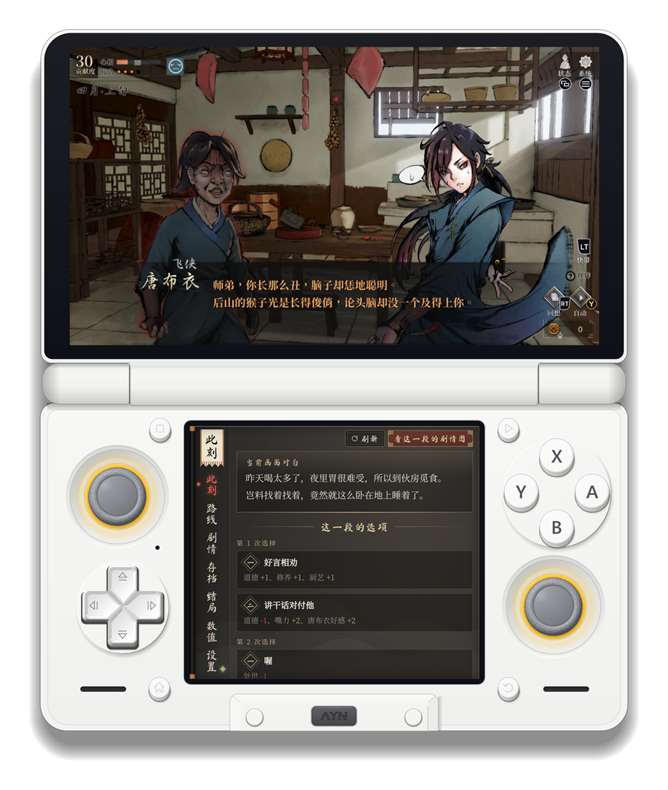
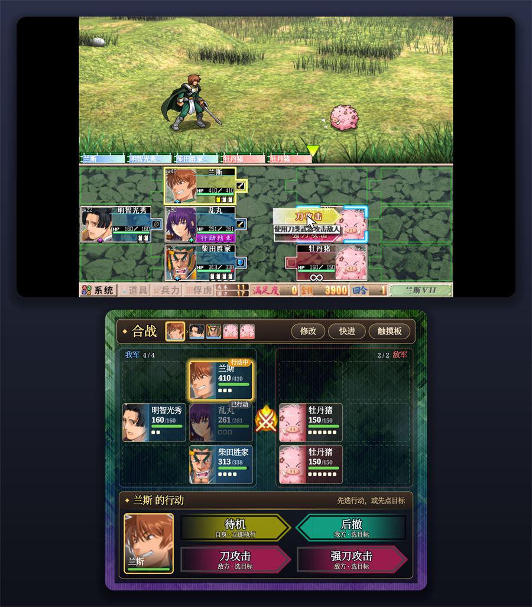
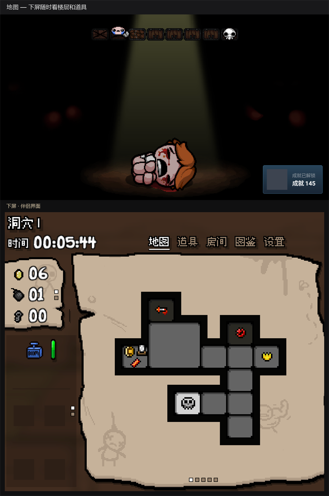
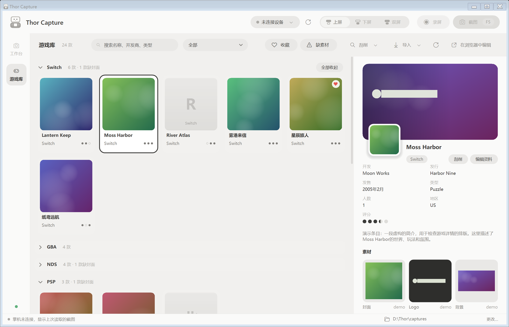
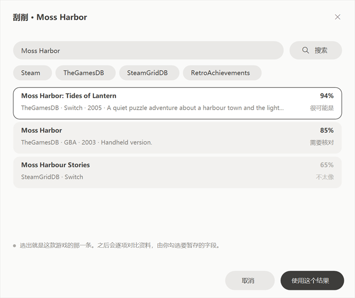
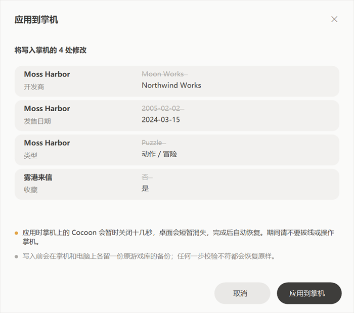

<h1 align="center">Thor Capture</h1>

<p align="center">
  <a href="README.md">简体中文</a> · <b>English</b>
</p>

<p align="center">
  A Windows tool for taking screenshots and recordings from the AYN Thor, which also happens to manage the Cocoon game library.
</p>

<p align="center">
  
</p>

<p align="center">
  <sub>The four shell colourways, each showing a real upper/lower capture from a Thor: Legend of Mortal (活侠传), The Binding of Isaac, Sengoku Rance and a visual novel.</sub>
</p>

---

The Thor has two screens. The built-in screenshot only grabs the one in focus, and the files are awkward to sort through on a PC. Thor Capture grabs both screens over USB debugging, previews them inside a drawn Thor, and exports them as a framed picture, a transparent PNG or a stitched dual-screen image.

Two more things I kept doing by hand ended up in here too: browsing and tidying the screenshots stored on the handheld, and editing Cocoon's game details, artwork and videos on the PC before writing them back.

<p align="center">
  
</p>

It's a single `ThorCapture.exe`, built against the .NET Framework that ships with Windows. Nothing to install, no NuGet packages.

> **Note:** the interface is in Simplified Chinese only. The screenshots below show it as it is.

## Contents

- [Screenshots and recordings](#screenshots-and-recordings)
- [Previewing inside the shell](#previewing-inside-the-shell)
- [Export](#export)
- [Screenshots on the handheld](#screenshots-on-the-handheld)
- [Game library](#game-library)
- [Getting started](#getting-started)
- [Building from source](#building-from-source)
- [Known limitations](#known-limitations)
- [More documentation](#more-documentation)

## Screenshots and recordings

- Pick the upper screen, the lower screen or both in the top bar and press <kbd>F5</kbd>. A dual capture saves two files that share a group name, and the gallery pairs them automatically.
- <kbd>F6</kbd> records using the device's own `screenrecord`: H.264 at native resolution, up to 180 seconds per clip. Dual recording starts both screens together and stops them together.
- System audio can be recorded as well (Android 13 or later). The microphone is never used and the handheld's speakers keep working.
- Live preview streams both screens to the PC as video. Resolution, bitrate and frame-rate caps are adjustable in the preview settings.
- Input feedback reads the gamepad and touch screen, so the buttons, sticks and touch points on the drawn shell move with you. While recording it saves a button timeline next to the clip, which the framed video export can turn into button animation.

The gallery is grouped by day and can be filtered to upper screen, lower screen or video, or searched by file name, date or foreground app. <kbd>Ctrl</kbd>/<kbd>Shift</kbd> to multi-select, <kbd>Del</kbd> to send to the Recycle Bin.

## Previewing inside the shell

The shell is drawn by the program, matched against photos of a real Thor rather than pasted in as an image. There are four colourways (black, white, rainbow and clear purple), and the stick lights can be recoloured, dimmed or turned off.

<table>
  <tr>
    <td width="58%"></td>
    <td>
      <p><b>The buttons work.</b> With no device attached you can press ABXY, push the D-pad and drag the sticks with the mouse; right-click a stick for L3/R3. It's only an animation and never sends anything to the handheld.</p>
      <p>With a device connected and input feedback on, the shell shows the buttons you're actually pressing.</p>
      <p>Four ways to look at a capture: <kbd>1</kbd> framed, <kbd>2</kbd> dual, <kbd>3</kbd> fit, <kbd>4</kbd> 1:1 pixels.</p>
    </td>
  </tr>
</table>

## Export

<kbd>Ctrl</kbd>+<kbd>E</kbd> opens the export window: a live preview on the left, the options on the right.

<p align="center">
  
</p>

- **Layout**: framed, stacked, side by side, or a captioned showcase page.
- **Background**: transparent, a few solid colours and gradients, or any colour you pick. A transparent PNG keeps the soft, semi-transparent edge of the shell's shadow, so it sits naturally on any page.
- **Padding, shadow and rounded screens**, plus PNG or JPEG and 1×–3× integer scaling (pixel-art games stay sharp).
- The window remembers your choices, and <kbd>Ctrl</kbd>+<kbd>Shift</kbd>+<kbd>C</kbd> copies straight to the clipboard in the same style. The clipboard also carries the PNG itself, so apps that support it paste it with transparency intact.

<table>
  <tr>
    <th>Framed, transparent background</th>
    <th>Stacked, gradient background</th>
    <th>Showcase page</th>
  </tr>
  <tr>
    <td></td>
    <td></td>
    <td></td>
  </tr>
</table>

Videos can be exported too: copy the two original clips, or combine them into one framed dual-screen MP4 with the button animation (needs FFmpeg).

## Screenshots on the handheld

Next to the gallery title there's a switch between the PC (电脑) and the handheld (掌机). The handheld side shows the pictures in the Thor's `Pictures/Screenshots` folder.

- The first time, the screenshots are copied to the PC; after that only new ones are fetched. You can still browse the last copy when the handheld isn't connected.
- `_dual` screenshots, with both screens in one picture, are split back into an upper and a lower screen, so they work with the shell preview and the showcase export like any other pair.
- Selected pictures can be copied into the PC gallery.
- Deleting here removes **the original on the handheld**. It asks first, and it can't be undone.

## Game library

The game library (游戏库) page manages the game list of the Cocoon launcher on the Thor.

<p align="center">
  
</p>
<p align="center"><sub>Shown with the built-in demo library; the covers are generated placeholders.</sub></p>

- **Read from the handheld**: reads Cocoon's database directly over USB. This needs a rooted Thor (Magisk). A game library folder already on the PC can be imported as well.
- **Grouped by platform**, with every group collapsible; filter by favourites or missing artwork.
- **Edit details**: name, developer, release date, genre, description, rating, hidden and so on.
- **Scrape** details and artwork from Steam, SteamGridDB, TheGamesDB, ScreenScraper, RetroAchievements and IGDB, then compare field by field and keep what you want. API keys go in the source settings.
- **Cover, logo, background and background video**: pick from the scraped results or choose a file on the PC.
- **Write back to the handheld**: every change is staged on the PC first and applied in one go once you confirm.

<table>
  <tr>
    <td></td>
    <td></td>
  </tr>
  <tr>
    <td align="center"><sub>Scraping: results ranked by match, you pick the right one</sub></td>
    <td align="center"><sub>Every change is listed before it's written back</sub></td>
  </tr>
</table>

While writing back, Cocoon is closed for ten seconds or so and the home screen briefly disappears. Before anything is written, a backup of the original database is kept both on the handheld and on the PC, and any failed check restores it. If the connection drops halfway, you're offered a recovery the next time the handheld is connected.

## Getting started

**What you need**

| For | You need |
|---|---|
| Screenshots, recording, preview | Windows 10 / 11; `adb` from the Android SDK platform-tools; USB debugging enabled on the Thor |
| Video preview, framed video, system audio | [FFmpeg](https://ffmpeg.org/) (with `ffprobe` in the same folder) |
| Game library | [Node.js](https://nodejs.org/) 22 or later and the Cocoon backend component `cocoon-art-backend` |
| Reading and writing the library on the handheld | A rooted Thor with `su` available |

**Where things go**

- `adb`: next to the exe, in a `platform-tools\` folder next to the exe, or with its full path written in `adb-path.txt` next to the exe.
- FFmpeg: the `THOR_FFMPEG` environment variable, `ffmpeg.exe` next to the exe, or `ffmpeg-path.txt`.
- Game library backend: a `cocoon\` folder next to the exe, or `cocoon-art-backend\` next to this repository.

Settings live in `thor-capture-settings.txt` next to the exe. Captures go to `captures\` next to the exe by default; the folder can be changed from the bottom bar.

**Keyboard shortcuts**

| Key | Does |
|---|---|
| <kbd>F5</kbd> / <kbd>F6</kbd> | Screenshot / start or stop recording |
| <kbd>1</kbd> – <kbd>4</kbd> | Framed / dual / fit / 1:1 |
| <kbd>Ctrl</kbd>+<kbd>E</kbd> | Export (video export when a video is selected) |
| <kbd>Ctrl</kbd>+<kbd>C</kbd> | Copy the original picture |
| <kbd>Ctrl</kbd>+<kbd>Shift</kbd>+<kbd>C</kbd> | Copy using the last export style |
| <kbd>Ctrl</kbd>+<kbd>F</kbd> | Search the gallery |
| <kbd>Space</kbd> | Play / pause video |
| <kbd>Del</kbd> | Delete (on the handheld side, deletes the original on the Thor) |

## Building from source

The compiler is the `csc.exe` that comes with Windows (C# 5), and only .NET Framework assemblies are referenced, so a fresh clone builds as is:

```powershell
./tools/build-capture-tool.ps1        # builds artifacts/ThorCapture.exe
./tools/test-capture-tool.ps1         # regression tests (fake adb, no device needed)
./tools/dev.ps1                       # dev mode: rebuild and restart on every change under src
./tools/render-check.ps1 -Window      # render the shell and the main window to evidence/ui-check
```

Under PowerShell 5.1, scripts containing Chinese text have to be saved as UTF-8 with BOM. The "fake adb" in the tests is the test executable itself, switched by `THOR_CAPTURE_TEST_MODE`; see `tests/Tests.cs`.

The pictures in this README are generated from real captures by `tools/ReadmeShots.cs`.

```
src/                 application source
  DeviceArt.cs         shell drawing and colourways
  Preview.cs           preview area, dual view and showcase
  MainForm*.cs         main window
  Features/            export, write-back, handheld screenshots and other modules
  Library/ UI/         game library client and screens
tests/               regression tests
tools/               build, test and render-check scripts
docs/                design and feature notes (mostly in Chinese)
third-party/scrcpy/  scrcpy-server used for system audio (unmodified, with its licence)
```

## Known limitations

- Dual screenshots and recordings start the two screens separately. They are not sampled on the same frame, so there's a small time offset between them.
- Live preview frame rate and latency depend on the USB link and the handheld's encoder. The fps shown is what the PC receives, not end-to-end latency.
- The button timeline uses the time the PC receives each event; the export lets you shift it by up to ±5 seconds.
- Writing back to the game library has been tested against a simulated device and a rehearsal copy on the handheld, but not yet run end to end on a live Cocoon database. Back up before the first real use.
- Touch orientation and system audio recording haven't been tested much on real hardware yet. Reports are welcome.
- The shell is an illustration drawn by the program, not an official render.

## More documentation

The detailed notes are written in Chinese.

- [Detailed guide](docs/GUIDE.md): recording, preview, input feedback and video export
- [Image export](docs/features/image-export.md) · [Handheld screenshots](docs/features/device-shots.md) · [Writing back to the handheld](docs/features/device-apply.md)
- [Game library frontend](docs/LIBRARY-FRONTEND.md) · [System audio](docs/RECORDING-AUDIO.md) · [Preview tuning](docs/PREVIEW-TUNING.md)
- [Architecture](docs/ARCHITECTURE.md) · [Roadmap](docs/ROADMAP.md) · [Changelog](CHANGELOG.md)

---

<sub>Thor Capture is a personal project and is not affiliated with AYN or Cocoon. AYN and Thor are trademarks of their respective owners. Game footage in the screenshots belongs to the respective rights holders.</sub>
