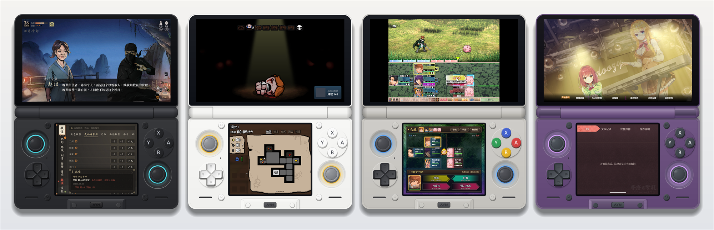
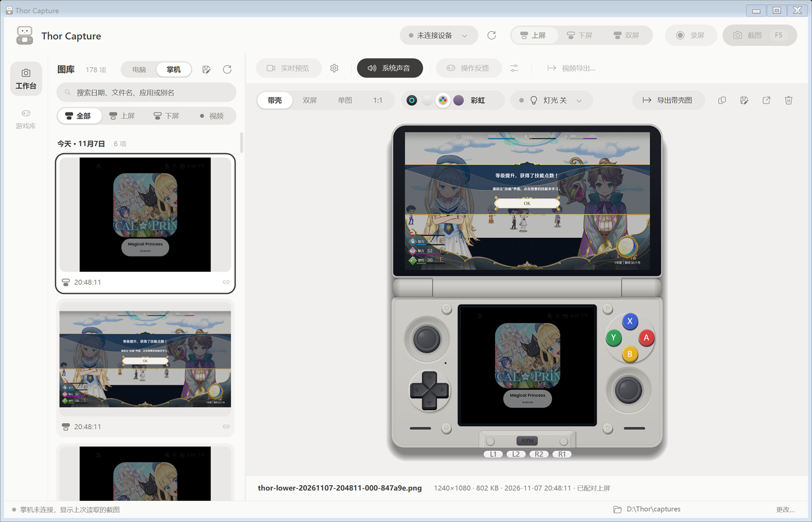
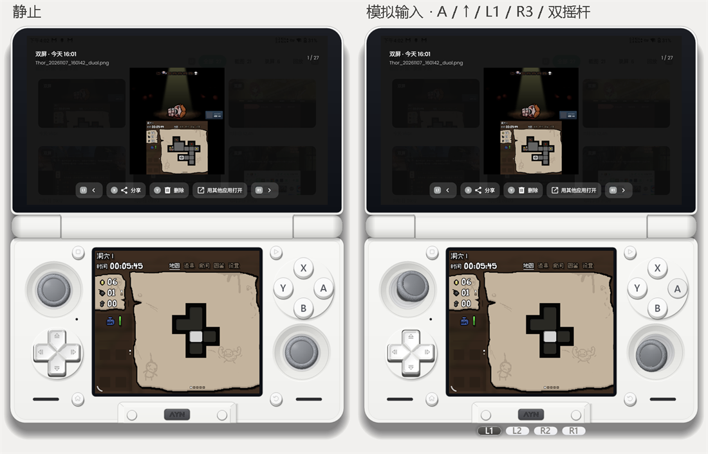
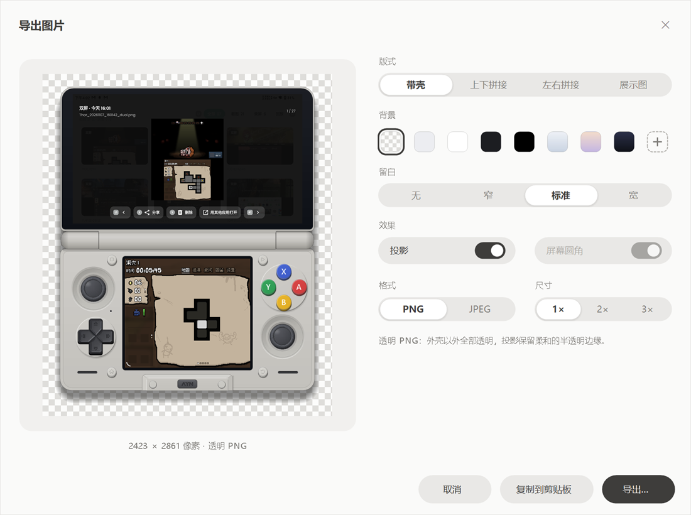
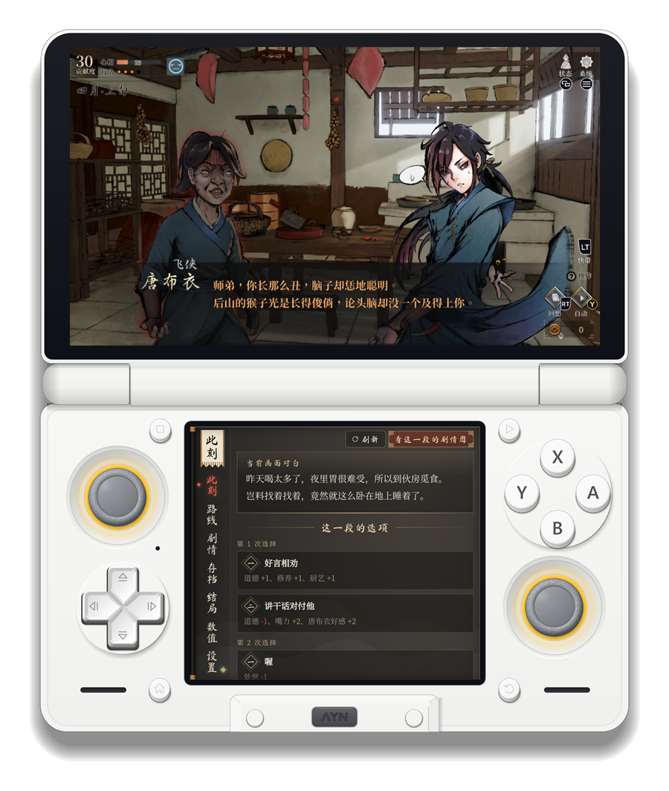
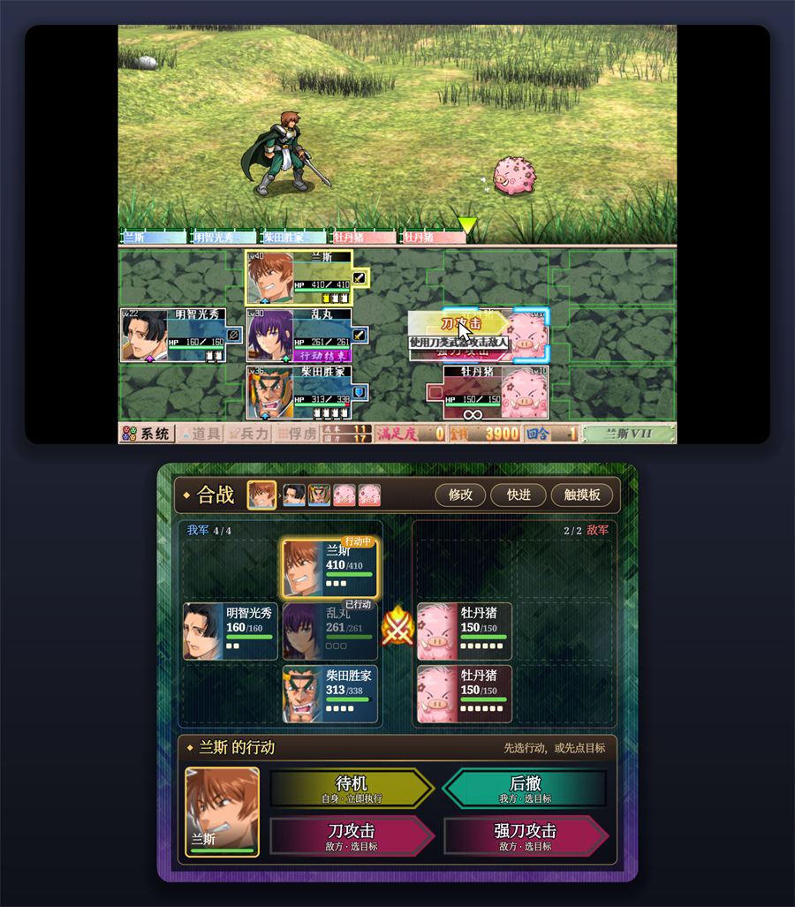
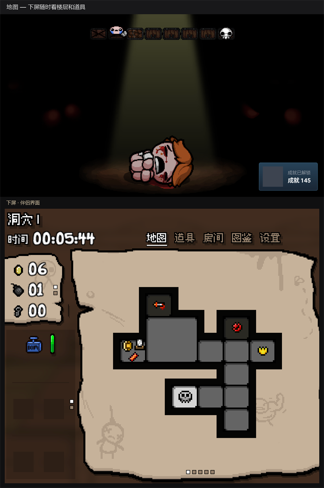
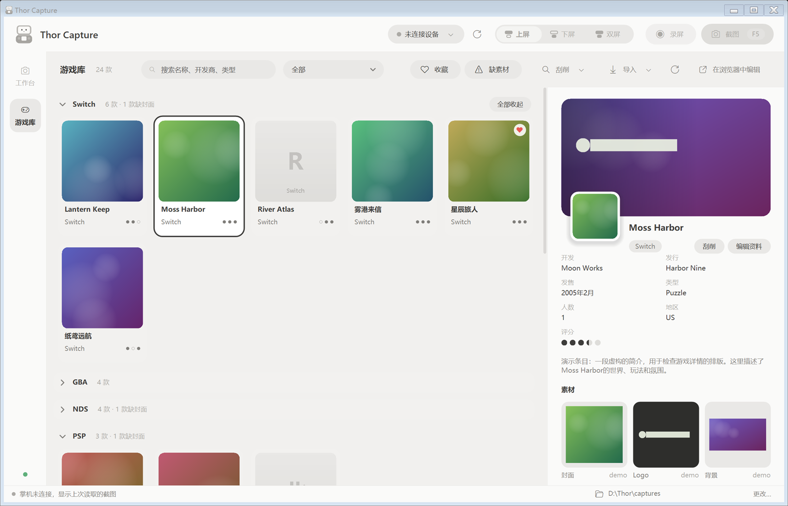
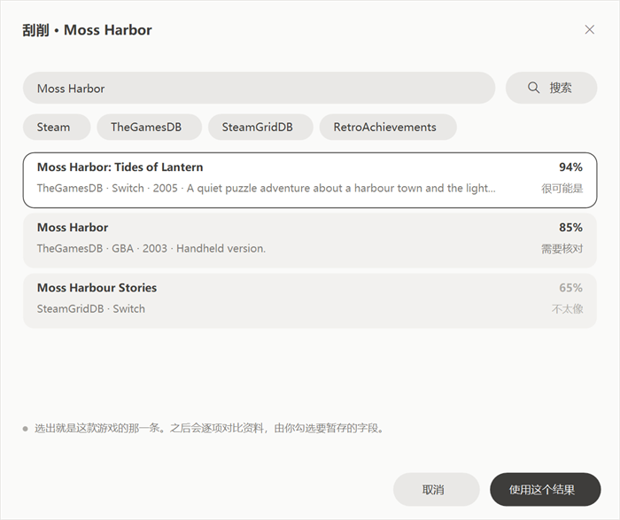
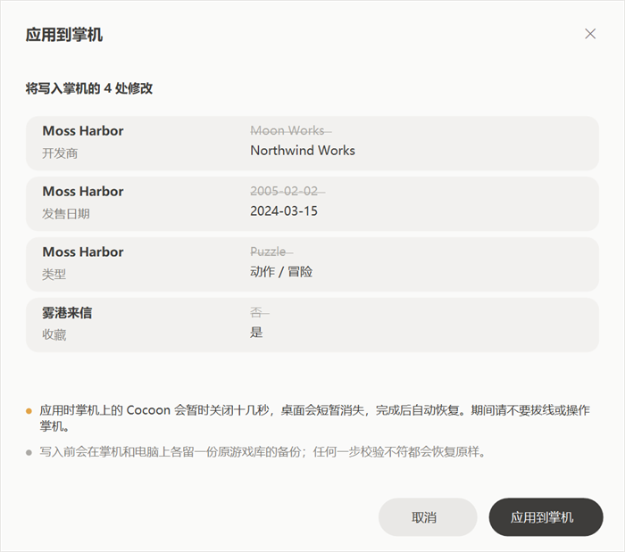

<h1 align="center">Thor Capture</h1>

<p align="center">
  <b>简体中文</b> · <a href="README.en.md">English</a>
</p>

<p align="center">
  给 AYN Thor 用的 Windows 截图、录屏工具，顺手把 Cocoon 游戏库也管了。
</p>

<p align="center">
  
</p>

<p align="center">
  <sub>四种机身配色，屏幕里是 Thor 上真实截下来的上下屏：活侠传、以撒的结合、战国兰斯，以及一款视觉小说。</sub>
</p>

---

Thor 有两块屏幕，系统自带的截图只会截当前那一块，也不方便在电脑上整理。Thor Capture 通过 USB 调试同时抓上下两屏，把它们放进一台画出来的 Thor 里预览，再按需要导出成带壳图、透明 PNG 或者拼好的双屏图。

后来又加了两件常做的事：直接浏览、整理掌机里存着的截图；在电脑上编辑 Cocoon 启动器的游戏资料、封面和视频，再写回掌机。

<p align="center">
  
</p>

整个程序是一个独立的 `ThorCapture.exe`，用 Windows 自带的 .NET Framework 编译，不需要安装，也不依赖 NuGet。

## 目录

- [截图与录屏](#截图与录屏)
- [放进外壳里看](#放进外壳里看)
- [导出](#导出)
- [掌机里的截图](#掌机里的截图)
- [游戏库](#游戏库)
- [开始使用](#开始使用)
- [从源码构建](#从源码构建)
- [已知限制](#已知限制)
- [更多文档](#更多文档)
- [许可证](#许可证)

## 截图与录屏

- 顶栏选「上屏 / 下屏 / 双屏」，按 <kbd>F5</kbd> 截图。双屏的两张图共用一个组名，图库里会自动配成一对。
- <kbd>F6</kbd> 录屏，用设备自带的 `screenrecord`，原生分辨率 H.264，每段最长 180 秒。双屏会同时开两路，一起停。
- 可以顺带录系统声音（Android 13 以上，不录麦克风，也不影响掌机外放）。
- 「实时预览」把两块屏幕的画面以视频流的方式传到电脑上，延迟和帧率可以在预览设置里调。
- 「操作反馈」读取手柄和触屏事件，外壳上的按键、摇杆和触点会跟着动；录屏时会存一份按键时间线，导出带壳视频时能把按键动画一起合成进去。

图库按日期分组，可以按上屏、下屏、视频筛选，也能搜文件名、日期和前台应用名。<kbd>Ctrl</kbd>/<kbd>Shift</kbd> 多选，<kbd>Del</kbd> 移入回收站。

## 放进外壳里看

外壳是程序按 Thor 实机照片一点点画出来的，不是贴图：黑、白、彩虹、透明紫四种配色，摇杆灯光的颜色和亮度可以调，也能关掉。

<table>
  <tr>
    <td width="58%"></td>
    <td>
      <p><b>按键是活的。</b>不连设备的时候，可以用鼠标按 ABXY、拖十字键和摇杆，右键按下摇杆就是 L3/R3。这只是演示动画，不会向掌机发送任何操作。</p>
      <p>连上设备开了「操作反馈」后，外壳显示的是你真正按下的键。</p>
      <p>预览区有四种看法：<kbd>1</kbd> 带壳、<kbd>2</kbd> 双屏、<kbd>3</kbd> 单图、<kbd>4</kbd> 1:1 原始像素。</p>
    </td>
  </tr>
</table>

## 导出

<kbd>Ctrl</kbd>+<kbd>E</kbd> 打开导出窗口，左边是实时预览，右边挑样式：

<p align="center">
  
</p>

- **版式**：带壳、上下拼接、左右拼接，或者带标题的展示图。
- **背景**：透明、几种纯色和渐变，也可以自己挑颜色。透明 PNG 会保留外壳阴影柔和的半透明边缘，放到什么底色上都不突兀。
- **留白、投影、屏幕圆角**，以及 PNG / JPEG 和 1×–3× 的整数倍放大（像素游戏放大后依然清晰）。
- 选好的样式会被记住，<kbd>Ctrl</kbd>+<kbd>Shift</kbd>+<kbd>C</kbd> 直接按这套样式复制到剪贴板。剪贴板里同时放了 PNG，支持的软件粘贴出来就是透明的。

<table>
  <tr>
    <th>透明背景的带壳图</th>
    <th>上下拼接 · 渐变背景</th>
    <th>展示图</th>
  </tr>
  <tr>
    <td></td>
    <td></td>
    <td></td>
  </tr>
</table>

视频也能导出：两段原片分别复制，或者合成一段带外壳、带按键动画的双屏 MP4（需要 FFmpeg）。

## 掌机里的截图

图库标题旁边有「电脑 / 掌机」切换。切到「掌机」，看到的就是 Thor 上 `Pictures/Screenshots` 里的图。

- 第一次会把截图存一份到电脑上，之后只取新增的；掌机没连着的时候也能翻看上次的。
- 上下屏拼在一张里的 `_dual` 截图会被拆回上屏和下屏，所以同样可以放进外壳、导出展示图。
- 选中后可以「复制到电脑图库」。
- 在这里按删除，删的是**掌机上的原图**，会先问一句，确认后不能撤销。

## 游戏库

左侧切到「游戏库」，管理的是 Thor 上 Cocoon 启动器的游戏列表。

<p align="center">
  
</p>
<p align="center"><sub>截图用的是程序自带的演示库，封面是生成的占位图。</sub></p>

- **从掌机读取**：通过 USB 直接读 Cocoon 的数据库，需要掌机已经 root（Magisk）。也可以导入电脑上已有的游戏库目录。
- **按平台分组**，每组都能收起；可以按收藏、缺素材筛选。
- **编辑资料**：名称、开发商、发售日期、类型、简介、评分、是否隐藏等。
- **刮削**：从 Steam、SteamGridDB、TheGamesDB、ScreenScraper、RetroAchievements、IGDB 搜索资料和图片，逐项对比后再决定用哪些字段。需要的 API 密钥在「来源设置」里填。
- **封面、Logo、背景、背景视频**：从刮削结果里挑，或者从电脑选一个文件。
- **写回掌机**：所有修改先暂存在电脑上，确认后一次性写回。

<table>
  <tr>
    <td></td>
    <td></td>
  </tr>
  <tr>
    <td align="center"><sub>刮削：按匹配程度排序，自己挑对的那一条</sub></td>
    <td align="center"><sub>写回前列出每一处改动</sub></td>
  </tr>
</table>

写回的时候 Cocoon 会暂时关闭十几秒，桌面会短暂消失。写入前会在掌机和电脑上各留一份原来数据库的备份，任何一步校验不对都会恢复原样；万一中途断线，下次连上时会提示恢复。

## 开始使用

**需要准备**

| 用途 | 需要什么 |
|---|---|
| 截图、录屏、预览 | Windows 10 / 11；Android SDK 的 `adb`（platform-tools）；Thor 上打开 USB 调试 |
| 视频流预览、带壳视频、录系统声音 | [FFmpeg](https://ffmpeg.org/)（需要同目录里有 `ffprobe`） |
| 游戏库 | [Node.js](https://nodejs.org/) 22 以上，以及 Cocoon 后端组件 `cocoon-art-backend` |
| 从掌机读写游戏库 | Thor 已 root，`su` 可用 |

**放置位置**

- `adb`：放在 exe 旁边，或者 exe 旁的 `platform-tools\` 里，或者把完整路径写进 exe 旁的 `adb-path.txt`。
- FFmpeg：环境变量 `THOR_FFMPEG`，或 exe 旁的 `ffmpeg.exe`，或 `ffmpeg-path.txt`。
- 游戏库后端：exe 旁的 `cocoon\`，或者与本仓库并排的 `cocoon-art-backend\`。

设置都存在 exe 旁的 `thor-capture-settings.txt` 里；截图默认保存在 exe 旁的 `captures\`，底栏可以改。

**常用快捷键**

| 按键 | 作用 |
|---|---|
| <kbd>F5</kbd> / <kbd>F6</kbd> | 截图 / 开始或停止录屏 |
| <kbd>1</kbd> – <kbd>4</kbd> | 带壳 / 双屏 / 单图 / 1:1 |
| <kbd>Ctrl</kbd>+<kbd>E</kbd> | 导出（选中视频时是视频导出） |
| <kbd>Ctrl</kbd>+<kbd>C</kbd> | 复制原图 |
| <kbd>Ctrl</kbd>+<kbd>Shift</kbd>+<kbd>C</kbd> | 按上次的导出样式复制 |
| <kbd>Ctrl</kbd>+<kbd>F</kbd> | 搜索图库 |
| <kbd>空格</kbd> | 播放 / 暂停视频 |
| <kbd>Del</kbd> | 删除（掌机模式下删除掌机上的原图） |

## 从源码构建

编译器用的是 Windows 自带的 `csc.exe`（C# 5），只引用 .NET Framework 自带的程序集，所以克隆下来就能编：

```powershell
./tools/build-capture-tool.ps1        # 输出 artifacts/ThorCapture.exe
./tools/test-capture-tool.ps1         # 本机回归测试（模拟 adb，不需要连设备）
./tools/dev.ps1                       # 开发模式：改动 src 后自动重新编译并重启
./tools/render-check.ps1 -Window      # 渲染外壳和主窗口截图到 evidence/ui-check
```

PowerShell 5.1 下含中文的脚本需要保存为 UTF-8 带 BOM。测试里的「假 adb」就是测试程序自己，按 `THOR_CAPTURE_TEST_MODE` 切换行为，见 `tests/Tests.cs`。

README 里的图片由 `tools/ReadmeShots.cs` 从真实截图生成。

```
src/                 程序源码
  DeviceArt.cs         外壳绘制与配色
  Preview.cs           预览区、双屏与展示图
  MainForm*.cs         主窗口
  Features/            导出、写回掌机、掌机截图等功能模块
  Library/ UI/         游戏库的客户端与界面
tests/               回归测试
tools/               构建、测试、渲染检查脚本
docs/                设计与功能文档
third-party/scrcpy/  录系统声音用的 scrcpy-server（未修改，附许可）
```

## 已知限制

- 双屏截图和录屏是两路分别启动的，不是同一帧采样，两屏之间会有一点时间差。
- 实时预览的帧率和延迟取决于 USB 和掌机编码器，程序显示的 fps 是电脑这边收到的帧数，不等于端到端延迟。
- 按键时间线以电脑收到事件的时间为准，导出时可以手动校正 ±5 秒的偏移。
- 写回游戏库目前在模拟设备和掌机上的演练副本里测过，还没有对真正的 Cocoon 数据库完整跑一遍，第一次用之前建议先备份。
- 触屏方向、录系统声音在实机上验证得还不够多，遇到问题欢迎反馈。
- 外壳是程序绘制的示意图，不是官方渲染图。

## 更多文档

- [详细说明](docs/GUIDE.md)：录屏、预览、按键反馈和视频导出的细节
- [导出图片](docs/features/image-export.md) · [掌机截图](docs/features/device-shots.md) · [写回掌机](docs/features/device-apply.md)
- [游戏库前端](docs/LIBRARY-FRONTEND.md) · [录系统声音](docs/RECORDING-AUDIO.md) · [预览调参](docs/PREVIEW-TUNING.md)
- [架构](docs/ARCHITECTURE.md) · [路线图](docs/ROADMAP.md) · [更新记录](CHANGELOG.md)

## 许可证

代码使用 [MIT 许可证](LICENSE)。打包附带的 scrcpy-server 使用 Apache License 2.0，见 [THIRD-PARTY-NOTICES.md](THIRD-PARTY-NOTICES.md)。

---

<sub>Thor Capture 是个人项目，与 AYN 和 Cocoon 没有关联。AYN、Thor 是其各自权利人的商标。截图中的游戏画面版权归各游戏的权利人所有。</sub>
